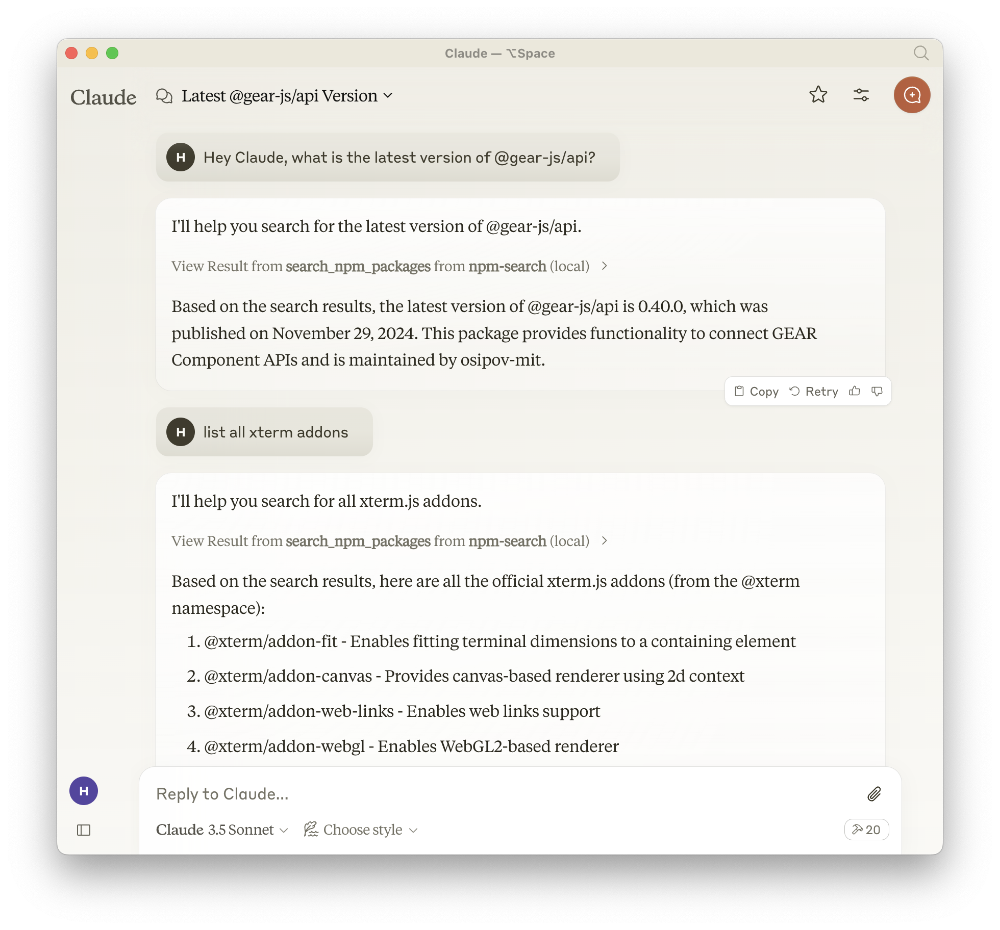

[](https://mseep.ai/app/btwiuse-npm-search-mcp-server)

# npm-search MCP Server
[](https://smithery.ai/server/npm-search-mcp-server)

A Model Context Protocol server that allows you to search for npm packages by calling the `npm search` command.

**Features:**
- Search npm packages using the `npm search` command
- Supports both stdio and HTTP (streamable-http) transport modes
- HTTP mode automatically enabled when `PORT` environment variable is set
- Structured logging with Pino
- Graceful shutdown handling
- Health check endpoint (`/health`)
- Session management for HTTP transport

<a href="https://glama.ai/mcp/servers/yeb3luefvf"></a>

### Available Tools

- `search_npm_packages` - Search for npm packages.
  - Required arguments:
    - `query` (string): The search query.



## Installation

### Installing via Smithery

To install npm-search for Claude Desktop automatically via [Smithery](https://smithery.ai/server/npm-search-mcp-server):

```bash
npx -y @smithery/cli install npm-search-mcp-server --client claude
```

### Using NPM (recommended)

Alternatively you can install `npm-search-mcp-server` via npm:

```bash
npm install -g npm-search-mcp-server
```

After installation, you can run it as a command using:

```bash
npm-search-mcp-server
```

### Using uv

When using [`uv`](https://docs.astral.sh/uv/) no specific installation is needed. We will
use [`uvx`](https://docs.astral.sh/uv/guides/tools/) to directly run *npm-search-mcp-server*.

## Configuration

### Configure for Claude.app

Add to your Claude settings:

<details>
<summary>Using npm installation</summary>

```json
"mcpServers": {
  "npm-search": {
    "command": "npx",
    "args": ["-y", "npm-search-mcp-server"]
  }
}
```
</details>

<details>
<summary>Using uvx</summary>

```json
"mcpServers": {
  "npm-search": {
    "command": "uvx",
    "args": ["npm-search-mcp-server"]
  }
}
```
</details>

### Configure for Zed

Add to your Zed settings.json:

<details>
<summary>Using npm installation</summary>

```json
"context_servers": {
  "npm-search-mcp-server": {
    "command": "npx",
    "args": ["-y", "npm-search-mcp-server"]
  }
},
```
</details>

<details>
<summary>Using uvx</summary>

```json
"context_servers": [
  "npm-search-mcp-server": {
    "command": "uvx",
    "args": ["npm-search-mcp-server"]
  }
],
```
</details>

## Example Interactions

1. Search for npm packages:
```json
{
  "name": "search_npm_packages",
  "arguments": {
    "query": "express"
  }
}
```
Response:
```json
{
  "results": [
    {
      "name": "express",
      "description": "Fast, unopinionated, minimalist web framework",
      "version": "4.17.1",
      "author": "TJ Holowaychuk",
      "license": "MIT"
    },
    ...
  ]
}
```

## Debugging

You can use the MCP inspector to debug the server. For uvx installations:

```bash
npx @modelcontextprotocol/inspector npx -y npm-search-mcp-server
```

Or if you've installed the package in a specific directory or are developing on it:

```bash
cd path/to/servers/src/npm-search
npx @modelcontextprotocol/inspector uv run npm-search-mcp-server
```

## Examples of Questions for Claude

1. "Search for express package on npm"
2. "Find packages related to react"
3. "Show me npm packages for web development"

## Docker

The server can be run in a Docker container with HTTP transport support:

```bash
# Build the image
docker build -t mcp/npm-search .

# Run the container (default port 3009)
docker run -p 3009:3009 mcp/npm-search

# Run with custom port via environment variable
docker run -p 3009:3009 -e PORT=3009 mcp/npm-search
```

The Docker image uses HTTP transport when the `PORT` environment variable is set. The server exposes:
- `POST /mcp` - Main MCP endpoint for tool calls and session initialization
- `GET /mcp` - SSE stream endpoint for streaming responses (requires session ID)
- `DELETE /mcp` - Session termination endpoint
- `GET /health` - Health check endpoint with service status and active session count

For Docker Compose integration:

```yaml
services:
  npm-search-mcp:
    build: .
    ports:
      - "3009:3009"
    environment:
      PORT: 3009
```

## Contributing

We encourage contributions to help expand and improve npm-search-mcp-server. Whether you want to add new npm-related tools, enhance existing functionality, or improve documentation, your input is valuable.

For examples of other MCP servers and implementation patterns, see:
https://github.com/modelcontextprotocol/servers

Pull requests are welcome! Feel free to contribute new ideas, bug fixes, or enhancements to make npm-search-mcp-server even more powerful and useful.

## License

npm-search-mcp-server is licensed under the MIT License. This means you are free to use, modify, and distribute the software, subject to the terms and conditions of the MIT License. For more details, please see the LICENSE file in the project repository.
